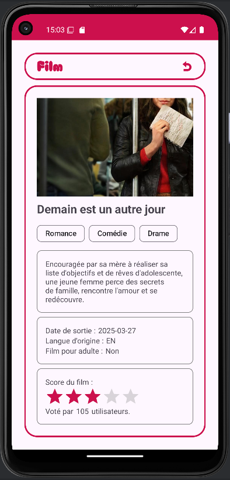

# Oh My Movies

> Multilingual Android movie discovery application built with Kotlin, Ktor, Coroutines, and the TMDB API.


## Overview

**Oh My Movies** is an Android mobile application powered by **The Movie Database (TMDB)** API. Users can browse popular movies, search by title, filter and sort results, and view full movie details in several languages.

## Features

- **Movie search and popular list:** Search films by query or browse popular titles.
- **Custom results list:** Displays poster artwork, title, release date, and tagline in a custom `ListView`.
- **Sorting options:** Sort results by popularity, release date, or alphabetical order.
- **Detailed movie screen:** Shows synopsis, poster, genres, release date, original language, adult flag, rating, and vote count.
- **Multilingual support:** Adapts interface text and TMDB API requests to the device language (`EN`, `FR`, `DE`, `ES`, `IT`, `EL`, with French fallback).
- **Screen rotation:** Handles portrait and landscape orientations smoothly.

## Screenshots

| Home and Search | Results | Movie Details |
| :---: | :---: | :---: |
|  |  |  |

## Technology Stack

- **Kotlin** and **Android SDK** (`minSdk 33`, `targetSdk 34`)
- **Ktor Client** for asynchronous HTTP requests to the TMDB API
- **Kotlin Coroutines** for non-blocking network calls
- **Kotlinx Serialization** for JSON parsing
- **Picasso** for dynamic poster loading and caching

## Project Structure

```text
├── .env.example                        # Environment variable template (TMDB_API_KEY)
├── app/src/main/
│   ├── java/com/example/ohmymovies/
│   │   ├── RechercheActivity.kt        # Main search and popular movies screen
│   │   ├── ResultatsActivity.kt        # Search results list and sorting
│   │   ├── FilmActivity.kt             # Movie detail view
│   │   ├── FilmAdapter.kt              # Custom ListView adapter
│   │   ├── DAO.kt                      # TMDB API client and JSON deserialization
│   │   └── Films.kt / FilmSearch.kt / FilmGetById.kt / Genre.kt
│   └── res/
│       ├── layout/                     # XML activity and item layouts
│       └── values-{de,el,en,es,fr,it}/ # Localized string resources
└── images/                             # Application screenshots
```

## Getting Started

1. **Create your `.env` file** from the template and add your TMDB API key:
   ```bash
   cp .env.example .env
   ```
   ```dotenv
   TMDB_API_KEY=your_tmdb_api_key_here
   ```
2. **Open the project in Android Studio** and sync Gradle dependencies.
3. **Run the application** on an Android emulator or physical device.

## License

All Rights Reserved. See [`LICENSE`](LICENSE) for details. No commercial use, modification, or redistribution is allowed without written permission.