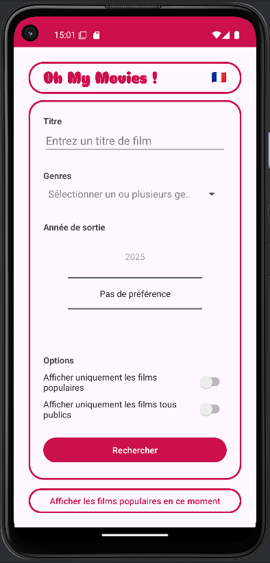
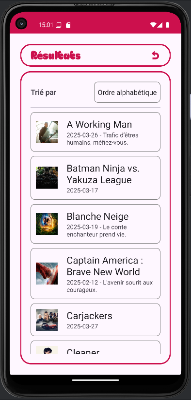

# Oh My Movies!

> Multilingual Android movie discovery app built with Kotlin, Ktor, Coroutines, and the TMDB API.

-2ea44f?style=flat-square)


## Overview

**Oh My Movies!** is an Android mobile application developed during BUT 2 (S4 — Mobile Development). Powered by **The Movie Database (TMDB)** API, it lets users browse popular films, search by title, filter/sort results, and explore rich movie detail pages in multiple languages.

## Features

- **Movie search & popular movies**: search films by query or browse currently popular titles.
- **Custom results list**: displays poster artwork, title, release date, and tagline in a custom `ListView`.
- **Sorting options**: sort results by popularity, release date (newest/oldest), or alphabetical order.
- **Detailed movie view**: synopsis, poster, genres, release date, original language, adult-content flag, user rating, and vote count.
- **Multilingual support (i18n)**: adapts UI strings and TMDB API requests to the device locale (`EN`, `FR`, `DE`, `ES`, `IT`, `EL`, with French fallback).
- **Responsive orientation**: handles portrait and landscape screen rotations seamlessly.

## Screenshots

| Home / Search | Results | Movie Details |
| :---: | :---: | :---: |
|  |  |  |

## Tech Stack

- **Kotlin** & **Android SDK** (`minSdk 33`, `targetSdk 34`)
- **Ktor Client** — asynchronous HTTP calls to the TMDB API
- **Kotlin Coroutines** — non-blocking network execution
- **Kotlinx Serialization** — JSON parsing
- **Picasso** — dynamic poster image loading and caching

## Project Structure

```text
├── .env.example                        # Environment variable template (TMDB_API_KEY)
├── app/src/main/
│   ├── java/com/example/ohmymovies/
│   │   ├── RechercheActivity.kt        # Main search & popular movies screen
│   │   ├── ResultatsActivity.kt        # Search results list & sorting
│   │   ├── FilmActivity.kt             # Movie detail view
│   │   ├── FilmAdapter.kt              # Custom ListView adapter
│   │   ├── DAO.kt                      # TMDB API client & JSON deserialization
│   │   └── Films.kt / FilmSearch.kt / FilmGetById.kt / Genre.kt
│   └── res/
│       ├── layout/                     # XML activity & item layouts
│       └── values-{de,el,en,es,fr,it}/ # Localized string resources
└── images/                             # App screenshots
```

## Getting Started

1. **Create your `.env` file** from the template and add your TMDB API key:
   ```bash
   cp .env.example .env
   ```
   Then edit `.env`:
   ```dotenv
   TMDB_API_KEY=your_tmdb_api_key_here
   ```
2. **Open the project in Android Studio** and sync Gradle dependencies.
3. **Run the application** on an Android emulator or physical device.

## Contributors

- Léa Cortet
- Maxime Bouzonie
- Clément Hubert